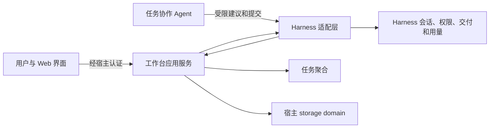

# 整体架构

Web 通过现有认证后的 Remote 入口进入应用服务。接口名和绑定机制需要完成适配验证，契约名为稳定逻辑操作。模型输入不可信，工具适配层从宿主当前会话推导任务绑定，检查可执行动作。领域状态变更由应用服务在宿主内统一写入。项目、会话、认证、文件权限和工具执行由原生 Harness 持有。

一次启动先原子写下 Run intent，后调用原生会话服务，再保存绑定。任何不确定阶段都保留 intent，只有明确关联才能恢复。投影可以在重启后从原生事件重新扫描，使用宿主提供的事件标识去重。文件、会话全文、原始请求与凭据留在其原生所有者处。

控制与故障边界、存储及记录版本见 [SECURITY](SECURITY.md) 和 [DATABASE](DATABASE.md)。模块依赖关系见 [MODULES](MODULES.md)。
